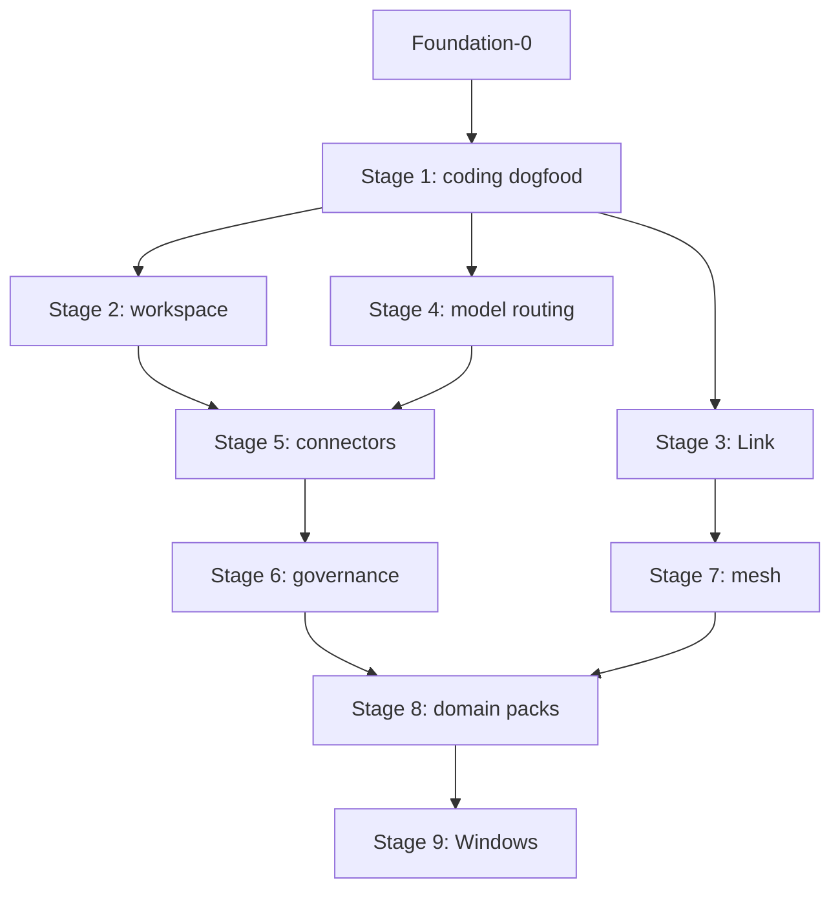

# Rikuri Pi — Foundation-0 Re-baselined Stage Plan v2.1

Sep 24, 2026 · @Henry C · Revised planning baseline

## Purpose and operating assumptions

Foundation-0 is re-baselined from 13 weeks to six stages over about nine months (Oct 1, 2026 → end June 2027). June is a planning target, with four to eight weeks of contingency reserved into July–August; unfinished gates move the date, never weaken the acceptance test. The W1 and F1–F10 outcome gates remain, with one additional F4-lite policy checkpoint. This is the live Stage Gate source; the 90-Day Build Plan v1.6 remains historical. Changes in this plan that alter a PRD, Architecture, or Engineering Standard promise must be reconciled by ADR before the affected stage starts.

The owner judges the **visible result**, not the code. Each stage ends with a short repeatable demo, a plain-language evidence receipt showing what passed and failed, and any remaining limitations. Deterministic tests, failure drills, and appropriately independent review certify technical claims; an agent's statement or the owner's inability to inspect code never counts as proof.

**Assumptions**

- One builder, approximately four focused days/week (about 16 build days/month). Agents may implement; deterministic gates and appropriate independent review certify.
- Ubuntu LTS is the only full Foundation-0 execution and security reference. Platform-neutral Rust core build, unit, and contract tests also run on macOS in CI. Native macOS execution-envelope assurance and desktop parity are deferred; they must never be advertised as proven.
- Prefer established components for infrastructure, after checking licenses, supported capabilities, integration cost, and failure behavior. The six time-boxed Rikuri-specific experiments in the register test distinctive claims; connecting existing components correctly still requires engineering and evidence.
- A stage is COMPLETE only when its vertical slice runs end to end and every listed test is green with linked evidence. No calendar date advances a stage.
- ADR 0000 records the reconciliation with PRD v1.1, Architecture v1.6, Engineering Standard v1.1, and Master Build Sequence v1.0. Freeze speculative redesign during execution; correct inaccurate requirements, security claims, and runbooks through an ADR and matching tests when evidence demands it.

**Item ID scheme**

`S<stage>.<ordinal>` for build items (e.g. `S01.04`), `T<stage>.<ordinal>` for tests, `E<n>` for experiments. Deferred v1.6 items keep their original name and gain a new ordinal in the Deferral table. An unchecked required box without a disposition row is not done.

**Changes from Build Plan v1.6**

| Change | v1.6 | v2.0 |
| --- | --- | --- |
| Duration | 13 weeks | About 9 months, 6 stages; 4–8-week contingency reserve |
| Importers in Foundation-0 | 4 (ChatGPT, Claude, Obsidian, Git) | 2 (ChatGPT, Markdown/Obsidian); Claude + Git → early Stage 1 after F2/F9 |
| macOS | continuous core build/test target | Keep platform-neutral core tests; native envelope and desktop assurance deferred |
| Composite / vision-specialist plans | Week 8 | post-Foundation Stage 4 (S4.5) |
| Module Contracts | all 14 crates from Week 1 | only crates that exist and are protected-core |
| Docs | changed with behavior | Keep operational docs and evidence current; architecture changes require ADR |
| Pi API spike | none | 2-day throwaway spike in Stage 00 (E2); early Ubuntu sandbox feasibility probe |

### Collaborative Intelligence scaffold rule

Foundation-0 does **not** implement Experience Intelligence, nightly reflection, user-pattern inference, Lightbulbs, cognitive ensembles, or adaptive RL. It **does** preserve the evidence those later systems would need: stable task/run/event IDs; exact execution/profile identity where available; versioned prompt/frame/context profile IDs when Rikuri transforms user intent; model/runtime/harness/tool identity; verification and outcome links; retries/fallback/escalation; cost/latency; human intervention/feedback; provenance; and privacy classification. Missing evidence that would make later learning irrecoverably ambiguous is treated as foundation debt and must be dispositioned before the relevant gate closes.

## Live gate board

Thirteen rows: Bootstrap, W1, F1–F10, and an added F4-lite policy checkpoint. The full F4 gate remains a single gate and closes in Stage 04 after the local runtime exists. The Stage 03 envelope proof is an intermediate prerequisite, not a second completed F4. A gate is COMPLETE only when the Evidence cell links a durable receipt (CI run, replay ID, smoke output, probe output).

| Gate | What it proves | Owner stage | Target | Status | Evidence |
| --- | --- | --- | --- | --- | --- |
| Bootstrap | CI blocks bad work; secret scan works; clean checkout runs full gate | 00 | Oct 2026 | NOT STARTED |  |
| W1 Kernel crash/continuity | kill -9 at every Stage 00 transaction point → rollback or deterministic recovery, no duplicate effects; full cross-component matrix closes at release | 00 | mid-Nov 2026 | NOT STARTED |  |
| F2 Real imports + provenance + idempotency | real ChatGPT export imported twice → same object count; provenance survives search | 01 | mid-Jan 2027 | NOT STARTED |  |
| F6 Rebuild + backup/wipe/restore + forget | indexes rebuild from canonical; forgotten object cannot materialize after restore | 01 | mid-Jan 2027 | NOT STARTED |  |
| F5 Hard $1 budget reservation stop | reservation exceeding ceiling → zero network call | 02 | early Mar 2027 | NOT STARTED |  |
| F7 Prompt-injection authority containment | imported malicious text searchable with zero authority; narration cannot alter approval text | 02 | early Mar 2027 | NOT STARTED |  |
| F4-lite Local Only containment (policy) | Local Only never enters a cloud package; denied before HTTP object exists | 02 | early Mar 2027 | NOT STARTED |  |
| F4 Cloud/local handoff + envelope proof | continue a task cloud → local without restatement; Local Only works only in a proven no-network envelope | 04 | end May 2027 | NOT STARTED |  |
| F9 Untrusted-project / descendant containment | read/index cannot execute; scoped promotion; child cannot escape parent envelope | 03 | mid-Apr 2027 | NOT STARTED |  |
| F10 Pi + Harness Profile coding slice | Pi edits, tests, returns diff/evidence through Rikuri tools; profile swap with zero kernel diff | 04 | end May 2027 | NOT STARTED |  |
| F1 Calm fresh-install Home | one-window Home works through real IPC | 05 | June 2027 | NOT STARTED |  |
| F3 Idea capture/retrieval/project attach | text Idea Inbox → search → attach to project | 05 | June 2027 | NOT STARTED |  |
| F8 Engineering Standard / evidence-first | every protected crate has contract, caller, health, tests; traceability current | 00 onward, final 05 | June 2027 | NOT STARTED |  |

### Owner-facing result at each stage

| Stage | What Henry can inspect without reading code | Technical receipt that backs it |
| --- | --- | --- |
| 00 | Run `init`, create a sample task, see the same state after a forced restart, and see a deliberately broken change fail CI. | Kernel crash matrix, replay IDs, red-test run, real CLI → store → ledger trace. |
| 01 | Search an imported conversation, open its original source, restore a managed backup, and see a forgotten item stay unavailable. | Import/retrieval corpus, provenance, old-backup restore and revocation tests. |
| 02 | See a $1 ceiling refuse an over-budget call with zero request sent; see why untrusted text has no authority and Local Only cannot enter a cloud request. | Budget/network probe, approval golden, injection corpus, knowledge conflict cases. |
| 03 | See an untrusted project opened without executing it and a malicious child visibly denied outside its granted scope. | In-envelope filesystem/network probes, descendant tests, security event IDs and alerts. |
| 04 | Watch one local coding task inspect, edit, test, and show a diff; continue a cloud task locally without restating it. | Pi adapter contract, profile swap, F4/F10 traces, handoff ACKs, replay/crash tests. |
| 05 | Use the one-window Home to repeat the complete task and capture/search/attach an idea on a clean machine. | Real IPC smoke, W1/F1–F10 evidence links, recovery and threat/control/test matrix. |

Each receipt says **Pass, Fail, or Not yet proven**, names the exact test/probe and date, links artifacts, records the limitation and the next decision, and provides a short reproduction script. The owner approves scope and visible usefulness; protected behavior is certified by gates and reviewers rather than by asking the owner to audit code.

## Stage 00 — Bootstrap + Kernel

**Oct 1 → mid-Nov 2026 (\~6 weeks).** Exit: `rikurid` survives kill -9 at every kernel transaction point and CI provably blocks bad work. Only throwaway feasibility probes touch Pi or the Ubuntu sandbox; no production model, UI, vector, or sandbox feature is built here.

**Build**

- [ ] S00.01 Rust workspace, lockfiles, `deny.toml`, protected-main Git workflow
- [ ] S00.02 CI: Ubuntu format → build → clippy → unit/contract → secret scan → ratchet; macOS platform-neutral core build/unit/contract checks; no `continue-on-error` on required gates
- [ ] S00.03 Small, reviewable `scripts/quality/full-gate.sh`, `smoke.sh`, `scrap-sweep.sh`; scripts validate real behavior and remain scripts, not products
- [ ] S00.04 `rikuri-domain`: stable IDs, privacy/risk enums, provenance, instruction authority, deletion unit, project-trust state, schema versions
- [ ] S00.05 `rikuri-storage`: SQLite bootstrap, migrations, `Repository<T>` trait with optimistic versioning
- [ ] S00.06 `rikuri-ledger`: append-only referenced-content events, idempotency rows, replay helpers
- [ ] S00.07 `rikurid` + `rikuri-cli`: `init`, dummy task, `state.show`, `ledger.tail`, `system.health`; versioned JSON envelope with typed errors and documented exit codes
- [ ] S00.08 `rikuri-testkit`: `FakeModelAdapter`, `FakeTool`, `CrashInjector`, `FixtureClock`, `FixtureIds`
- [ ] S00.09 Module Contracts for the four crates that exist (domain, storage, ledger, testkit)
- [ ] S00.10 ADR 0001–0004 (ID format, SQLite current-state model, ledger + idempotency, threat-model assumptions)
- [ ] S00.11 E1 spike: simplest implementation of the Transactional State Evolution invariant for kernel transactions (see Experiment register); later components extend the crash matrix
- [ ] S00.12 E2 spike: Pi headless driveability, 2 days, throwaway branch
- [ ] S00.13 One-day Ubuntu sandbox admission probe on the exact reference installation: can `bwrap` create the required user/network/mount namespaces under default AppArmor settings without globally weakening security? Record a viable approved fallback or block Stage 03 planning if not.

**Adopt (do not build)**

| Need | Component | Note |
| --- | --- | --- |
| Database | rusqlite or sqlx with SQLite | WAL mode, one writer |
| IDs | ULID or UUIDv7 | sortable, no custom format |
| Property tests | proptest | state-machine style for ledger |
| Dependency policy | cargo-deny | license + advisory gate |
| Secret scan | gitleaks | pre-commit + CI |

**Tests — complete when all green**

- [ ] T00.01 Red-test drill: planted failing test blocks CI; removed → green
- [ ] T00.02 Secret drill: planted key fixture blocks CI without printing the key
- [ ] T00.03 Clean Ubuntu checkout runs `full-gate.sh` from README alone; platform-neutral core suite passes on macOS CI
- [ ] T00.04 Repository contract suite: versioned put/get, transaction rollback, migration compatibility
- [ ] T00.05 Ledger contract suite: append, query, idempotency reject on replay
- [ ] T00.06 Property: no duplicate consequential effect across randomized command sequences with injected crashes
- [ ] T00.07 Kernel crash matrix points 1–3 and 6 (before transaction, after state write before event, after commit, after idempotency before UI response): rollback or deterministic recovery (**W1**). Tool, budget, and backup crash points run when those systems exist, and all eight rerun at release.
- [ ] T00.08 Controlled regression: idempotency disabled → W1 fails (proves the gate bites)
- [ ] T00.09 CLI → kernel → repository → ledger exercised as one real path; CLI and in-process adapters pass the same JSON/error contract
- [ ] T00.10 Smoke checks a content marker in `state.show`, not just process liveness
- [ ] T00.11 Module Contract check: every crate in `crates/` has a contract file with owns/must-not-own/health

**Stage 00 exit decision**: W1 green, Bootstrap green, E1/E2 and the Ubuntu sandbox admission probe recorded with outcomes, current macOS core suite green, four Module Contracts, and baseline scope ADR plus ADR 0001–0004 accepted.

## Stage 01 — Ownership Core

**mid-Nov 2026 → mid-Jan 2027 (\~8 weeks, holiday-adjusted).** Exit: your real chat history is imported, encrypted, searchable with provenance, backed up, restorable on a clean machine, and forgettable. If the project stopped here it would still be a useful tool.

**Build**

- [ ] S01.01 `rikuri-content`: encrypted blobs, per-deletion-unit DEK, key registry, materialize/forget lifecycle
- [ ] S01.02 Canonical object families: project, source, source\_version, conversation, message, source\_span, idea, artifact, relation, version, tombstone
- [ ] S01.03 Importer contract: source → validated candidates + provenance + hashes; parser cannot write canonical DB; all-or-nothing transaction
- [ ] S01.04 ChatGPT importer (minimum + representative + changed-schema fixtures)
- [ ] S01.05 Markdown/Obsidian snapshot importer (links, frontmatter, Unicode/CJK)
- [ ] S01.06 Project Registry + Resource Resolver with authoritative location and trust state (`untrusted_read` default)
- [ ] S01.07 FTS5 search returning canonical/source IDs + provenance; `VectorIndex` trait declared, not implemented
- [ ] S01.08 Generated Markdown projection (one-way out); user vault imported as versioned source (one-way in)
- [ ] S01.09 Retrieval corpus: ≥ 20 known-answer questions from real imported history, frozen in `tests/retrieval/`
- [ ] S01.10 `rikuri-backup`: consistent snapshot (SQLite + ciphertext + key/recovery metadata + manifest + versions), `backup`, `restore --verify`, `forget <id>`; design a durable revocation record independent of any one old snapshot so a managed restore cannot silently restore deleted keys
- [ ] S01.11 Managed restore applies the latest durable revocation record before materialization. If an old snapshot arrives without trustworthy current revocation state, block or visibly quarantine its sensitive material pending explicit recovery; never silently claim it is safe.
- [ ] S01.12 ADR 0005–0008 (crypto-shredding contract, import identity/idempotency, FTS5 + VectorIndex boundary, two one-way Markdown flows)
- [ ] S01.13 E3 spike: deletion-aware restore determinism (see Experiment register)

**Adopt (do not build)**

| Need | Component | Note |
| --- | --- | --- |
| Content encryption | XChaCha20-Poly1305 through a vetted implementation that supports it, such as RustCrypto `chacha20poly1305` | Pin and review version; unique nonce strategy; one DEK per deletion unit, wrapped by a master key |
| Hashing | BLAKE3 | content + manifest integrity |
| Lexical search | SQLite FTS5 | mandatory baseline; vectors deferred |
| Backup container | tar + JSON manifest | no custom format |
| Markdown parse | pulldown-cmark | frontmatter via serde\_yaml |

**Tests — complete when all green**

- [ ] T01.01 Importer contract suite passes for both importers (inspect/parse/validate/idempotency/error atomicity)
- [ ] T01.02 Real ChatGPT export imported twice → identical canonical object count (**F2**)
- [ ] T01.03 Changed-schema ChatGPT fixture imports or fails cleanly with a stable error code, never partial
- [ ] T01.04 Malformed/truncated source → zero partial canonical commit
- [ ] T01.05 Property: identical re-import never increases object count
- [ ] T01.06 Search → provenance → open original source span works for every corpus question
- [ ] T01.07 Retrieval corpus baseline hit rate recorded and CI-gated as a no-regression floor
- [ ] T01.08 Delete all derived indexes → rebuild → corpus passes identically; canonical state unchanged (property)
- [ ] T01.09 Forget one object → plaintext cannot materialize; absent from projection, index, search; tombstone remains
- [ ] T01.10 Sequence: create → backup A → forget X → purge → backup B → wipe → restore B → X cannot materialize. Also restore the *pre-forget* managed backup A with the current revocation record → X cannot materialize. Restore A without a trustworthy revocation record → safe refusal/quarantine, never silent resurrection (**F6**).
- [ ] T01.11 Restore onto clean Ubuntu environment from docs alone; `restore --verify` passes integrity manifest
- [ ] T01.12 One real schema migration through backup → upgrade → restore
- [ ] T01.13 Unicode/CJK content round-trips through import, DB, FTS, projection
- [ ] T01.14 Crash matrix point 8 (during backup snapshot creation): no corrupt backup written
- [ ] T01.15 Documented case: user restores an unmanaged old export by hand; Rikuri does not claim to revoke or erase copies outside its managed restore path

**Stage 01 exit decision**: F2 and F6 green from clean checkout; retrieval floor recorded; E3 outcome recorded; ADR 0005–0008 accepted; Module Contracts for content, import, search, backup.

## Stage 02 — Trust and Money

**mid-Jan → early Mar 2027 (\~7 weeks).** Exit: one approved synthetic cloud-model test can run against a hard dollar ceiling, imported text never acquires instruction authority, and Local Only content is refused at the policy layer before any network object exists. Envelope proof of that refusal comes in Stage 03.

**Build**

- [ ] S02.01 `rikuri-security`: privacy admission, capability decision, risk classes, trusted-approval schema
- [ ] S02.02 `rikuri-context`: versioned Context Package with provenance, `instruction_authority`, privacy class, source span/content ref, valid/observed time, supersession/conflict status, and a minimal policy-aware Knowledge Context Compiler with explicit abstention
- [ ] S02.03 Auto / Private / Local Only (Vault) project and workspace policy semantics; policy persists across task and handoff
- [ ] S02.04 Imported/retrieved/model/tool content defaults to `instruction_authority: none`; Secret class excluded from all model packages
- [ ] S02.05 `rikuri-budget`: integer microdollar accounting; reserve → call → reconcile → release; parent envelope for retries
- [ ] S02.06 Price catalog with provenance; stale/unknown price → hard-dollar mode unavailable for that path
- [ ] S02.07 One tested OpenAI-compatible cloud access path behind `ModelAdapter`, using synthetic non-sensitive fixtures during this stage; reject Local Only before HTTP request construction. Other providers require capability-specific contract tests and may need native adapters later.
- [ ] S02.08 Trusted Approval Renderer: normalized tool + arguments + risk → deterministic consequence text
- [ ] S02.09 AISecurity detectors wired as advisory signals only; no LLM is root allow/deny authority
- [ ] S02.10 Prompt-injection fixture corpus: direct override, role hijack, exfiltration, encoded payload, delimiter injection, misleading explanation, benign lookalikes
- [ ] S02.11 Local sanitization / minimal-reproduction interface for optional frontier reasoning
- [ ] S02.12 ADR 0009–0012 (Context Package + authority model, hard-budget reservation, egress-by-construction policy layer, approval semantics + injection containment)
- [ ] S02.13 E4 spike: Knowledge Context Compiler supersession rules (see Experiment register)

**Adopt (do not build)**

| Need | Component | Note |
| --- | --- | --- |
| Provider wire format | OpenAI-compatible chat completions for the first tested access path | Treat any gateway as its own declared capability; do not assume one adapter is production-ready for every provider |
| Money arithmetic | `i64` microdollars | no floats, ever |
| Injection detection signals | existing AISecurity detectors | advisory only; September 2026 protection matrix converted to regression corpus |
| HTTP | reqwest with explicit client per adapter | request object built only after admission passes |

**Tests — complete when all green**

- [ ] T02.01 Golden Context Package fixtures: provenance survives retrieval; imported content has `instruction_authority: none`; Local Only excluded from cloud packages; Secret excluded from all packages
- [ ] T02.02 Property: content cannot self-promote `instruction_authority` across any operation sequence
- [ ] T02.03 Local Only cloud package construction denied before the HTTP request object exists (**F4-lite**)
- [ ] T02.04 Project privacy persists across task and handoff and overrides routing eligibility
- [ ] T02.05 Budget: reservation fits → call → reconcile → release remainder
- [ ] T02.06 Budget: reservation exceeds remaining → **zero** network call, proven by `NetworkProbe`, not a log line (**F5**)
- [ ] T02.07 Property: `spent + reserved <= ceiling` for every admitted paid request across retry/reserve sequences
- [ ] T02.08 Provider returns missing usage → state marked estimated per policy, never silently zero
- [ ] T02.09 Stale/unknown price → hard-dollar profile fails safely; historical price evidence stable after current price changes
- [ ] T02.10 Crash matrix point 7 (during reservation/reconciliation): no leaked reservation, no double charge
- [ ] T02.11 Approval golden: same normalized tool + args → identical consequence text regardless of model narration
- [ ] T02.12 Every injection corpus item remains searchable with zero authority; benign lookalikes are not flagged (**F7**)
- [ ] T02.13 ModelAdapter contract suite: identity, normalized request/response, cancellation, usage/error normalization, budget preflight; fake and live share kernel/policy/ledger/budget code
- [ ] T02.14 Security health becomes Degraded when required enforcement probe is absent
- [ ] T02.15 Knowledge Context Compiler: all 10 supersession/conflict cases meet their expected outcomes; current supported claims are returned where the fixture requires an answer, and uncertain or consequential conflicts explicitly abstain with a reason. Zero unsafe acceptance; an always-abstain implementation fails. Stable low-risk facts trigger no needless verification.

**Stage 02 exit decision**: F5, F7, F4-lite green; E4 outcome recorded; ADR 0009–0012 accepted; Module Contracts for security, context, budget.

## Stage 03 — Execution Boundary

**early Mar → mid-Apr 2027 (\~6 weeks).** Exit: a process launched under a Rikuri envelope on Ubuntu provably cannot read outside its mount or reach the network, and an untrusted repository cannot execute code during inspection. This is the hardest stage; E5 runs in week one and can stop the line.

**Build**

- [ ] S03.01 `rikuri-platform`: normalized OS Capability API (process, filesystem, network, service, sandbox contracts)
- [ ] S03.02 `platform-ubuntu` + `envelope-ubuntu` adapters; assurance descriptor per profile (filesystem, network, privilege, backend/version, verification time)
- [ ] S03.03 `platform-macos` compiles and platform-neutral core contract/unit tests pass in CI; native macOS envelope retains `assurance: experimental`, with no protection claims
- [ ] S03.04 ProjectTrust contract: `untrusted_read` → `trusted_scoped_execute` → `revoked/review_required`; promotion is explicit, scoped, and renders consequences
- [ ] S03.05 Descendant-process policy: children inherit parent envelope; parent binary name (`git`, `cargo`, `npm`) grants nothing
- [ ] S03.06 Executable-metadata inspector: `.git/config` (`core.fsmonitor`, helpers), hooks, npm lifecycle scripts, Make/Cargo/Python build hooks, Docker/devcontainer/MCP/workspace configs
- [ ] S03.07 Trust invalidation/review rule when tracked executable metadata changes
- [ ] S03.08 Launch workers only through the declared Ubuntu envelope; preflight mount/network/namespace assurance and mark a profile unavailable if the probe cannot establish its guarantees. Full cloud-to-local task handoff is S04.15.
- [ ] S03.09 Provenance chain: request → grant/deny → tool call → result → alert, linked by stable event IDs
- [ ] S03.10 Session-sequence signal: bulk reads followed by staging/compression/egress, or repeated denied escalation, triggers configured response
- [ ] S03.11 ADR: envelope assurance levels (was 0011 scope); ADR: project trust + descendant containment
- [ ] S03.12 E5 spike: envelope assurance as tested property (see Experiment register)

**Adopt (do not build)**

| Need | Component | Note |
| --- | --- | --- |
| Filesystem + PID isolation | bubblewrap (`bwrap`) candidate | Requires successful Stage 00 probe on the pinned Ubuntu image and AppArmor configuration; never disable system-wide namespace restrictions to make a test pass |
| Network denial | Linux network namespace (`--unshare-net`) | no interfaces = no egress; probe from inside |
| Path allow-listing | Landlock (kernel ≥ 5.13) | belt to bwrap's braces |
| Syscall filtering | seccomp-bpf via `libseccomp` | conservative default profile |
| Git metadata parsing | `gix-config` / `git2` read-only | never invoke `git` binary during inspection |

**Tests — complete when all green**

- [ ] T03.01 OS Capability fake + Ubuntu adapter share one contract suite
- [ ] T03.02 Worker reads Local Only test file inside allowed mount; cannot read a path outside the envelope
- [ ] T03.03 Worker cannot connect to external IP, resolve DNS, or complete HTTP when `external_network = Denied`; failure observed from inside the envelope (**F4 envelope prerequisite**, full F4 remains open)
- [ ] T03.04 No-network assurance failure → profile marked unavailable; no silent downgrade
- [ ] T03.05 ExecutionEnvelope contract: declared assurance matches observed filesystem/network behavior
- [ ] T03.06 Untrusted project opened/read/indexed with no project-controlled side effect
- [ ] T03.07 Malicious `core.fsmonitor` fixture does not execute during read-only inspection; untrusted `git status` path cannot run a configured helper
- [ ] T03.08 Git hook, npm lifecycle, Make/Cargo/Python hook, devcontainer/MCP fixtures each detected and reported, none executed
- [ ] T03.09 Explicit trust promotion renders scope and consequences; after promotion, malicious child attempts filesystem/network/secret escape and is denied (**F9**)
- [ ] T03.10 Property: parent-command approval does not expand descendant authority; child cannot exceed parent envelope
- [ ] T03.11 Mutating tracked executable metadata fires trust re-review/invalidation
- [ ] T03.12 Denied operation produces deterministic security decision + evidence; material blocks emit a user-visible alert (silent block fails the gate)
- [ ] T03.13 Provenance reconstruction from a single event ID recovers the full chain
- [ ] T03.14 Local Only refuses cloud and runs a synthetic task only inside the proven envelope; exercise the policy and envelope together. Cloud → local continuity is T04.16.
- [ ] T03.15 Native/local fixtures: daemon interruption, flags/xattrs/ACLs, copy/export/exfiltration attempt, bulk sequential reads → configured session response
- [ ] T03.16 AISecurity regression matrix runs for supported paths; no prior BLOCKED cell silently becomes ALLOWED

**Stage 03 exit decision**: F9 and the F4 envelope prerequisite green; full F4 remains open until Stage 04. E5 outcome recorded; envelope + trust ADRs accepted; Module Contracts for platform and the two Ubuntu adapters; macOS core checks green with native envelope explicitly experimental.

## Stage 04 — Pi Harness + Local Coding Slice

**mid-Apr → end May 2027 (\~6 weeks).** Exit: a local model, driven by Pi under a Harness Profile, edits a file in a trust-promoted project, runs its declared test, and returns diff plus evidence through Rikuri tools, and a second profile swaps in with zero kernel diff. Composite lead-plus-specialist plans are deferred to post-Foundation Stage 4.

**Build**

- [ ] S04.01 `rikuri-exec`: `HarnessAdapter` trait (session/turn/tool/result/cancel lifecycle), `Tool` trait (schema + risk + execute + verify), `ExecutionEnvelope` launch
- [ ] S04.02 `adapters/harness-pi`: Pi driven headlessly with Rikuri tools injected; Pi types never cross crate boundaries
- [ ] S04.03 Harness Profile schema: family / task / runtime / hardware / privacy / project overlays, versioned; `HarnessProfileStore`
- [ ] S04.04 Runtime-compatibility record separate from agent/profile-compatibility record; status values Optimized / Experimental / Unavailable
- [ ] S04.05 `adapters/local-openai-compat`: llama.cpp server as the one local runtime
- [ ] S04.06 Minimal coding profile: read / search / edit / diff / run declared test; bounded terminal; result verification
- [ ] S04.07 Capability providers advertise tools but hold no authority until policy issues a task-scoped capability token
- [ ] S04.08 Minimal Execution Registry: model / access / runtime / harness / price records as data; router selects by capability, privacy, access, budget, never by model name
- [ ] S04.09 Minimal Task Space contract frozen (isolated terminal/editor/files/credentials/network/log ownership, explicit handoff); no rich UI
- [ ] S04.10 Capability metadata: modalities, tools, structured output, streaming, runtime/hardware fit, privacy eligibility; missing metadata is explicit
- [ ] S04.11 Two profile fixtures: one synthetic family + one second compatible family
- [ ] S04.12 ADR: Pi integration boundary and native-harness exception criteria; ADR: Harness Profile schema
- [ ] S04.13 E6 spike: profile swap with zero kernel diff (see Experiment register)
- [ ] S04.14 Read-only `KnowledgeService` harness tools with scoped capability and source/provenance return; the worker cannot read the canonical store or derived index directly
- [ ] S04.15 Cloud-to-local handoff uses Rikuri-owned task state: cloud synthetic task → local continuation without restatement; Local Only uses only the proven envelope; IDs/ACKs and budget accounting survive the handoff

**Adopt (do not build)**

| Need | Component | Note |
| --- | --- | --- |
| Harness substrate | Pi | default for local/open models; no home-grown full harness |
| Local runtime | llama.cpp server (OpenAI-compat endpoint) | reuse Stage 02 adapter shape; stock llama.cpp, no LeanKV/TQ integration needed |
| Reference harnesses | Qwen Code, DeepSeek Harness | read source for profile test ideas only; no adapters |
| Diff | `similar` crate | unified diff for evidence |

**Tests — complete when all green**

- [ ] T04.01 `PiHarnessAdapter` contract suite: session, tool, result, cancellation, evidence behavior normalized
- [ ] T04.02 `HarnessProfile` contract suite: versioned overlay validation and compatibility metadata
- [ ] T04.03 Vertical slice: open synthetic project untrusted → search/read through Pi, assert no executable surface runs → promote scoped trust → Pi edits one file, runs declared test, returns diff + verification evidence (**F10**)
- [ ] T04.04 Project process and local-model process cannot write canonical DB; only `rikurid` commits
- [ ] T04.05 Malicious child-process escape attempt during the Pi slice is denied (re-runs T03.09 through the harness path)
- [ ] T04.06 Swap to second profile fixture: same core execution path, no kernel diff, no project-state loss
- [ ] T04.07 Property: adding a compatible model/profile requires registry/profile data only; kernel has no model-name branch (grep gate + fixture)
- [ ] T04.08 Disable profile support deliberately → status Experimental/Unavailable, never silent fallback
- [ ] T04.09 Runtime-compatible but agent-incompatible checkpoint is not shown as Optimized
- [ ] T04.10 Fake and live harness paths share kernel, policy, ledger, budget, verification code (contract suite proves it)
- [ ] T04.11 Second synthetic model/access/price record added by data only; router picks by capability/privacy/budget
- [ ] T04.12 Crash matrix points 4–5 (before tool side effect; after side effect before result event): no duplicate consequential effect
- [ ] T04.13 Handoff IDs/ACKs: missing ACK, stale tail, truncated handoff, detached caller each produce a typed failure, never green health
- [ ] T04.14 Headless runtime continues a task across client detach/reattach without losing canonical state or duplicating effects
- [ ] T04.15 Replay: recorded model/tool trace reapplied through the same kernel path yields identical ledger
- [ ] T04.16 Cloud → local handoff continues a task without restatement and with current ProjectState; Local Only refuses cloud and proceeds only in the proven envelope (**F4**)
- [ ] T04.17 Pi searches known-answer corpus through scoped `KnowledgeService` tools; direct storage/index access denied

**Stage 04 exit decision**: F4 and F10 green; E6 outcome recorded; Pi + profile ADRs accepted; Module Contracts for exec, scoped knowledge tools, and harness-pi.

## Stage 05 — Minimal Home + Foundation Freeze

**June 2027 (\~5 weeks).** Exit: a one-window desktop client runs the whole Foundation slice over versioned IPC on a clean machine, and Architecture v1.7 is frozen from what was actually built. Precondition: W1, F2, F4, F5, F6, F7, F9, F10 all green. If not, resequence UI; do not weaken gates.

**Build**

- [ ] S05.01 Tauri one-window client; talks to `rikurid` only through the versioned local IPC (JSON-RPC provisional); UI never opens SQLite
- [ ] S05.02 Home: prompt box, minimal capability launcher, recent work, health / needs-attention
- [ ] S05.03 Text Idea Inbox; `idea.capture`, `idea.attach`; Search and Project views
- [ ] S05.04 Approval card rendered from the Trusted Approval Renderer output; no UI-side narration
- [ ] S05.05 Settings: execution endpoint, key reference (never key value), local runtime, privacy default
- [ ] S05.06 `en` + `en-XA` pseudo-locale resource files; no visible English outside resources; stable error codes from core
- [ ] S05.07 Minimal coding view embeds Monaco only if F10 was uneventful; otherwise deferred to Stage 1 (record disposition)
- [ ] S05.08 Health board: last-success / Degraded for every required component
- [ ] S05.09 Threat → control → test → evidence traceability table complete for all Foundation promises
- [ ] S05.10 Master Build Sequence reordered to match actual Foundation evidence
- [ ] S05.11 ADR 0015: Architecture v1.7 freeze recording every deviation from plan

**Adopt (do not build)**

| Need | Component | Note |
| --- | --- | --- |
| Desktop shell | Tauri 2 | webview + Rust host; one window |
| i18n resources | Fluent (`.ftl`) or ICU MessageFormat | pseudo-locale generated from `en` |
| Editor (if S05.07 proceeds) | Monaco | embed only; no LSP/DAP |

**Tests — complete when all green**

- [ ] T05.01 UI smoke checks distinct content and behavior markers, not window creation
- [ ] T05.02 Home → project → untrusted state → promote → Pi coding task → diff/test evidence, through real IPC (**F1**)
- [ ] T05.03 Capture text idea → search finds it with provenance → attach to project → visible in project view (**F3**)
- [ ] T05.04 Approval card content equals renderer golden output byte-for-byte
- [ ] T05.05 Pseudo-locale expands strings and exposes clipping; CJK sample content round-trips into the UI
- [ ] T05.06 Client detach/reattach mid-task: task continues, state unchanged (re-runs T04.14 through the UI)
- [ ] T05.07 Last-success health fixture: absence of success becomes Degraded on the board

**Release gate (Foundation-0 done)**

- [ ] W1 + F1–F10 green from clean checkout
- [ ] Clean Ubuntu machine: install → import → retrieve → open untrusted → privacy mode → promote scoped trust → Pi edit/test → budget/cloud/local handoff → backup/restore/forget, from docs alone
- [ ] Platform-neutral macOS core build/unit/contract tests pass in CI; native macOS envelope and full desktop remain explicitly unverified
- [ ] Full crash/replay matrix (points 1–8) green
- [ ] Retrieval corpus does not regress below the Stage 01 floor
- [ ] No security fixture can acquire authority; hard-budget tests show zero calls beyond ceiling
- [ ] Every protected-core crate: Module Contract + real caller + health signal + tests (**F8**)
- [ ] Build Records COMPLETE/ABANDONED with disposition; Stage Gate Records match evidence
- [ ] No unexplained skipped tests, debt-ratchet increase, or repeated fallback; an independent reviewer or separately generated adversarial test set challenges the high-impact security and restore claims before release
- [ ] Every deferred item has reason, dependency impact, new ordinal, owner, reactivation trigger
- [ ] ADR index current; ADR 0015 accepted; Stage 6 Paperclip evaluation recorded as deferred research with pinned version
- [ ] Architecture and docs describe what was built; the owner-facing result receipts and short reproduction demos for Stages 00–05 match the actual evidence

## Experiment register

Six Rikuri-specific claims are deliberately time-boxed. Each spike has a kill criterion; keep/simplify/drop is recorded in an ADR before the dependent stage closes. A separate one-day Stage 00 Ubuntu sandbox admission check tests the selected platform, without pretending it proves E5. Reuse other components where justified, but verify their integration and failure behavior in Rikuri.

| ID | Claim under test | Spike | Time box | Kill criterion → fallback | Stage | Outcome |
| --- | --- | --- | --- | --- | --- | --- |
| E1 | Find the simplest implementation satisfying Transactional State Evolution and last-known-good recovery | Compare versioned SQLite transaction with an explicit candidate/promotion design at Stage 00 kernel crash points; rerun all eight real points after dependent modules exist | 3 days initial spike | If versioned SQLite transactions satisfy the same invariant and crash tests, omit redundant ceremony; if neither passes, Stage 00 remains open | 00; full matrix at 05 |  |
| E2 | Pi can be driven headlessly with Rikuri tools injected and results captured, without leaking Pi types | Throwaway branch: start Pi session, inject one fake tool, capture tool call + result + cancel | 2 days | Cannot inject tools or capture results → escalate: either Pi extension work or reconsider harness substrate before Stage 04 | 00 |  |
| E3 | Deletion-aware managed restore cannot resurrect a forgotten item, including a managed snapshot made before forgetting | Create backup A → forget X → create backup B; wipe and restore each with durable revocation state; attempt A without revocation state; test randomized orderings | 2 weeks | If guarantee cannot be proven, keep F6 red and redesign revocation/restore; a weaker promise requires explicit owner decision and a changed requirement, never an unchanged green F6 | 01 |  |
| E4 | Minimal Knowledge Context Compiler can use source authority, time, supersession, conflict, and risk to avoid unsafe context | 10 hand-built cases with explicit answer/abstain expectations, including consequential stale/conflicting claims and stable low-risk facts | 1 week | Ship the smallest rule table that meets each expected outcome; unsafe acceptance or abstaining on a required clear answer blocks Stage 02. Later stages may improve ranking and coverage, not postpone the safety gate | 02 |  |
| E5 | Envelope network and filesystem denial are tested properties on the pinned Ubuntu image, not prompts | After Stage 00 feasibility check, test `bwrap` under default AppArmor with DNS/TCP/HTTP and out-of-mount reads from inside; verify allowed work still succeeds | 1 week | No deterministic denial without weakening host security → STOP LINE; choose an independently tested alternative via ADR before Stage 03 can close | 03 |  |
| E6 | A second model family/profile swaps in with zero kernel diff | Second synthetic profile fixture; `git diff crates/rikuri-kernel` must be empty; grep gate for model names in kernel | 3 days | Kernel `match` on family required → profile schema is wrong; fix schema before F10 | 04 |  |

**Rules for experiments**

- Spike code lives on a throwaway branch and is deleted or promoted in the same change; no silent third state.
- The kill criterion is written before the spike starts and cannot be softened mid-spike. A fallback may simplify implementation; it cannot silently relax a P0 user promise or rename an unproven gate green.
- "It probably works" is not an outcome; the Outcome cell links a Build Record with probe output.

## Deferral and resequencing table

Every v1.6 Foundation item that moved is listed here with a disposition, per the Master Build Sequence protocol. Nothing is dropped from the product; it is dropped from the Foundation critical path. Rows are ordered by new ordinal.

| v1.6 item | Disposition | New ordinal | Reason | Dependency impact | Reactivation / acceptance condition |
| --- | --- | --- | --- | --- | --- |
| Claude importer (Week 4–5) | RESEQUENCED | S1.01 (early Stage 1) | Two importers prove the contract; a third adds fixtures, not architecture | None on F2; Stage 1 dogfood wants it | F2 green; Importer contract suite passes for the new parser |
| Git/project manifest importer, read/untrusted (Week 4–5) | RESEQUENCED | S1.02 (early Stage 1, before repository dogfood) | Needs ProjectTrust from Stage 03 to be meaningful | Stage 04 slice uses a synthetic project instead | Stage 03 F9 green; import cannot promote trust (T03.06 rerun) |
| `VectorIndex` implementation + retrieval tuning (Week 4–5) | DEFERRED | Stage 1 | FTS5 baseline is mandatory; vectors are a quality experiment | Retrieval floor set by FTS only | Real dogfood retrieval failures that FTS cannot fix; corpus ≥ 40 questions |
| `KnowledgeService` read-only harness tools (Week 4–5) | RESEQUENCED | S04.14 | Needs a harness to call it | Stage 04 adds it once Pi is wired | F10 vertical slice exercises search through scoped tools |
| Native macOS execution envelope and desktop parity (all weeks) | DEFERRED | Stage 1+ | Ubuntu is the sole full Foundation assurance target | No native macOS protection claim; platform-neutral core tests remain continuous | Ubuntu Foundation gate green, followed by macOS threat model and native assurance tests |
| Composite execution plan, lead + specialists, vision-specialist fixture (Week 7–8) | DEFERRED | Stage 4 (S4.5) | Single-agent evidence precedes composition | Router in S04.08 is single-role | Registry modality metadata + single-role F10 stable |
| Local sanitization / minimal-reproduction for frontier reasoning (Week 6) | KEPT | S02.11 | — | — | — |
| Session-sequence anomaly signals (Week 9) | KEPT | S03.10 | — | — | — |
| Monaco in Foundation coding view (Week 10) | CONDITIONAL | S05.07 | Only if F10 was uneventful | None | Disposition recorded at Stage 05 start |
| Localization set beyond `en` + pseudo-locale (Week 10) | DEFERRED | Stage 2 | Resource boundary is proven by pseudo-locale alone | None | Stage 2 window contracts green |
| Full Module Contracts for all 14 crates (Week 1) | RESEQUENCED | per stage | Contracts written when the crate exists | None | Each stage exit lists its crates |
| Build Records for every change (all weeks) | KEPT, scaled by risk | ongoing | One brief evidence record per coherent change; full risk/test detail for protected-core or irreversible paths | No silent untracked change; routine documentation is brief | Engineering Standard v1.1 remains in force; record has plan, wiring, verification, close-out |
| Checklist / Build Record / traceability validators as tooling (Bootstrap) | NARROWED | S00.03 | Small scripts, not a new quality product | Required red gate and evidence still run | A later Project Quality Manager is a Stage 6+ item |
| Speculative PRD/Architecture redesign during Foundation-0 | CONTROLLED | S05.11 retrospective freeze | Avoid spec gravity while allowing corrections tied to evidence | Baseline scope reconciled before Stage 00; changed promises require ADR + tests | Stage 05 ADR records implementation deviations; operational docs update with behavior |
| S1.1–S9 post-Foundation goals (v1.6 §5) | INTENT KEPT | see next section | Master stage order retained; early Stage 1 importers now explicit | No Foundation gate relies on those importers | Each later stage is re-estimated from the prior gate |

## Post-Foundation stages 1–9

The Master Build Sequence v1.0 order stands. Dates are removed; each stage activates only when its predecessor gate is green. Pacing below is a solo-builder estimate for planning conversations, not a commitment.

Stages 2, 3 and 4 each depend only on Stage 1, so they can be sequenced by what dogfood pain says is worst; Stage 5 needs both workspace and routing.

| Stage | Gate (from Master Build Sequence) | Key adopt decisions | Solo pacing | Novel-claim experiments to run first |
| --- | --- | --- | --- | --- |
| 1 Pi coding dogfood + developer platform | First add S1.01 Claude importer and S1.02 read-only Git manifest importer, then plan → code → diff → test → gate → commit one real Rikuri feature through Rikuri | Monaco, tower-lsp clients, portable-pty, git2 | about 3 months | Dogfood Foundation claims; F2 and F9 preconditions for importers |
| 2 Sterling Workspace + plugin surface | Chat + Monaco + terminal + tests + agent + logs coexist, link, detach, restore after restart | Tauri multi-window; egui/wgpu only if webview cannot do freeform windows | \~3 months | Context/Agent/Prompt Link protocol; broadcast isolation |
| 3 Rikuri Link | Leave home network, continue a task, approve a step, reconnect, recover same job; no relay plaintext, no router port | Tailscale first; native rendezvous/E2E relay later | \~2 months (Tailscale path) | Idempotent command delivery over reconnect |
| 4 Model Lab + routing | New compatible model needs registry/profile data + evaluation, not core code; Auto explains its choice | llama.cpp / vLLM / Ollama behind one runtime trait; stock builds, no LeanKV/TQ dependency | \~3 months | Learned Auto router (evidence-only admission); Fast Decision Model shadow (S4.1) |
| 5 Browser + connectors + assistant | Common assistant request works from natural language without exposing plumbing or expanding authority | Isolated browser profile per Task Space; MCP as connectivity only | \~3 months | Attention Firewall; connector least-authority tokens |
| 6 Multi-agent governance + Project Graph | Plain-language request assembles one worker or a justified team; long-running workflow survives restart, compaction, model swap, cancellation | Paperclip evaluated at pinned revision per mechanism (S6.2 ADRs) before any adoption | \~4 months | Workflow IR; coordinator/evaluator separation; Strategy Council trigger policy |
| 7 Personal Mesh + responsibilities | Replacement / offline / reconnect / concurrent-update converge without silent loss; backup independent of sync | Encrypted event replication; CRDT only where simultaneous text editing is proven necessary | \~3 months | Conflict semantics; hub optionality |
| 8 Domain packs + Live Companion | Each domain is a projection over common primitives; no independent mini-brain | Whisper-class local transcription; embeddable editors | open | Per-domain, none foundational |
| 9 Windows parity + business readiness | OS Capability parity after Ubuntu/macOS stable; tenancy without weakening personal foundations | Windows sandbox primitives (AppContainer / job objects) | open | Tenancy boundary |
| 10 Collaborative Intelligence / Inquiry & Discovery | Evidence-backed Experience Intelligence and cognitive-recipe learning improve selected human+AI workflows; Inquiry/Discovery surfaces useful questions/connections without promoting speculation to truth | Prefer existing observability, statistics, retrieval, bandit/optimization and verification components behind Rikuri contracts | research/experimental | Begin prototypes only after Stage 4 execution evidence and Stage 6 governance are available; productization remains post-Foundation |

Rough total from Foundation-0 exit to Stage 6 gate: about 18 months of stage estimates, with further contingency for discovery and integration. This is a planning range, not an end-of-2028 promise.

## Stop-the-line rules and document control

The v1.6 stop-the-line table carries forward unchanged. Three rules are added for this re-baseline.

| Signal | Required response |
| --- | --- |
| CI / red-test does not actually block | STOP; fix gate before code |
| Module passes unit tests but has no real caller | NOT COMPLETE; wire it before next dependent feature |
| Pi/model profile needs a model-name branch in kernel | STOP; move behavior to registry/profile/adapter |
| UI/client becomes owner of task or agent-loop state | STOP; move canonical state back into `rikurid` |
| Untrusted project can execute during inspection | STOP LINE; security architecture failure |
| Descendant escapes parent envelope | STOP LINE; do not trust parent executable name |
| Local Only cannot prove external network denied | Profile unavailable; no silent downgrade |
| Budget max cannot be bounded | Hard-dollar mode unavailable for that access path |
| Probabilistic evaluator becomes authority | STOP; advisory only |
| Backup restores forgotten content | STOP RELEASE |
| Repeated fallback hides dead primary | Mark Degraded, fix primary, add tripwire |
| Item postponed | Disposition + reason + impact + new ordinal + owner + trigger; reorder dependents now |
| **New:** an experiment's kill criterion fires | Record fallback in ADR the same day; the dependent stage cannot close on the original claim |
| **New:** a baseline requirement changes mid-build | ADR explains evidence, affected gates, tests, migration, and new scope; update PRD/Architecture and runbooks in the same change. Park speculative ideas only. |
| **New:** stage reaches 70% of its estimated time with required gates at risk, or exceeds 150% | Reforecast scope/date from evidence; use contingency, resequence dependents, and never compress the next stage or waive a gate |

**Document control**: ADR 0000 reconciles this plan with the PRD, Architecture, Engineering Standard, and Master Build Sequence, including Ubuntu-only release assurance and continuously tested macOS core. Thereafter, speculative additions go to `docs/PARKING_LOT.md`; necessary changes to claims, security boundaries, acceptance criteria, and runbooks require an ADR plus matching tests and current documentation. Stage 05 ADR 0015 records what implementation actually proved. This plan, operational docs, ADRs, Build Records, Stage Gate Records, and Module Contracts remain live throughout Foundation-0.

**Next actions (this week)**

- [ ] Copy this plan to `docs/stage-gates/foundation0/00-plan-v2.md` and create one Stage Gate Record per stage from Template B
- [x] ADR 0000 reconciles the PRD, Architecture, Engineering Standard, and Master Build Sequence with this scope (September 24, 2026); preserve continuous macOS core tests and defer native envelope claims.
- [ ] Run the one-day Ubuntu namespace/AppArmor admission probe on the actual reference image and schedule E2 for the first two build days of October
- [ ] Agree on the six owner-facing stage demos and evidence-receipt format before the first build change
