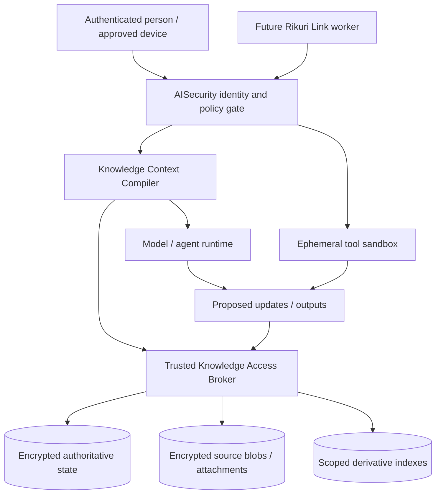

# Rikuri Pi — Personal Intelligence Vault
## Foundation Architecture & Stage-1 Development Amendment

**Status:** Proposed specification for integration into Rikuri Pi's existing PRD, architecture, engineering standards, and Stage-1 plan  
**Prepared:** 2026-10-30  
**Scope:** Identity-owned, private-by-default, encrypted, durable, model-agnostic and machine-agnostic knowledge; future-proofed for multi-user home mesh  
**Companion:** `Rikuri_Pi_Rikuri_Link_Home_Intelligence_Mesh.md`  
**Version note:** This is an independent amendment, **not** a claim that earlier numbered Rikuri documents have been merged or superseded. Retain existing version numbers until reconciliation.

---

## 1. Executive decision

**Build the Personal Intelligence Vault (PIV) as a Stage-1 foundation, not as a later knowledge feature.** All durable personal intelligence—original sources, conversation history, project state, authorized memories, evidence, provenance and verified outputs—shall be owned by stable identities and governed by a trusted knowledge access boundary. Models, inference runtimes, devices, agents and sandboxes are replaceable consumers, **not owners**, of this information.

**Nonnegotiable invariant:** *Compute may be shared; private knowledge is never implicitly shared.*

**Stage-1 success:** One person can maintain independently scoped projects and threads, securely store and retrieve their material, switch models, export and restore the vault on another machine, and pass a simulated two-user / two-project isolation test **before** Home Mesh is implemented.

**Do not build now:** A complete family collaboration product, cross-machine GPU orchestration, general-purpose end-to-end encrypted group synchronization, dedicated GPU virtualization, or custom cryptography. Design compatible contracts and migration paths now.

### Mission alignment

> Portable personal intelligence and accumulated knowledge remain under an individual's control, independent of model vendor, operating system, computer or temporary execution environment. Knowledge sharing is voluntary, attributable and revocable for future access where technically possible.

## 2. Problem and threat model

### 2.1 Protected assets

1. Original user files and imported source records (including photos, audio, messages and research).
2. Private conversations, thread histories, tool outputs and agent scratch results.
3. Structured memories, knowledge links, claims, uncertainty and provenance.
4. Project Lifecycle Kernel authoritative state and approved artifacts.
5. Embeddings, retrieval chunks, summaries, semantic indexes, adapters, prompt/KV/media caches and other derived data that can reveal source information.
6. Encryption keys, credentials, access grants and audit evidence.
7. Backups, exports and recovery materials.

### 2.2 Adversaries and failures to design against

- Another household member, agent, project or client accidentally or deliberately retrieving unauthorized material.
- Prompt injection in imported documents attempting to override access rules.
- A sandbox, runtime adapter or inference server accidentally retaining another project's context.
- Malicious local processes, compromised remote worker, insecure API exposure, stolen storage or backup media.
- Broken migrations, partial writes, stale-tail substitution, silently dropped updates or lost encryption keys.
- Administrator of a shared host: **explicit trust boundary**. Standard host-side encryption and microVM/container use do **not** guarantee that plaintext used for inference is hidden from a privileged or compromised host administrator.

### 2.3 Security modes and user promise

- **Auto / Smart:** Optimizes execution *within the user's pre-authorized privacy boundary*. Never silently transmit private material to unapproved devices, cloud models or third parties.
- **Private / Trusted Devices:** Permits explicitly authorized privately controlled machines to process data; users understand that trusted execution machines see plaintext needed for their jobs.
- **Vault / This Device Only:** Decryption and sensitive inference remain on the approved device. A remote mesh worker cannot receive plaintext from a Vault-only job. Fail closed if local resources are insufficient.

> These are routing and trust policies, not three different databases. Every object can carry an effective privacy label and its permitted execution destinations. Clearly distinguish privacy **from other users** from privacy **from the host administrator**.

## 3. Core architectural boundaries



**Responsibilities must remain separate:**

| Component | Owns / does | Must not do |
|---|---|---|
| Identity and key service | Durable principals, device trust, unlock, key wrapping and recovery | Automatically expose all vaults to a household administrator |
| AISecurity / authorization engine | Policy decisions for read, retrieve, act, write, share, export | Delegate access control to LLM instructions |
| Knowledge Access Broker | Enforce scopes, stream allowed objects, stage and commit writes | Offer raw unrestricted DB / vault-directory mounts to agents |
| Knowledge Context Compiler | Verify provenance, freshness, purpose and relevance of allowed context | Treat remembered statements or retrieved text as unquestioned truth |
| Authoritative store | Versioned structured user/project/thread state and event history | Make Markdown the canonical database |
| Blob + derivative store | Source objects, attachments, scoped indexes, regeneration manifests | Retain unauthorized derived data after deletion/revocation |
| Model and sandbox adapters | Execute ephemeral work with least privilege | Become authoritative record of personal knowledge |

## 4. Day-one data model and ownership

Every durable record SHALL have a stable ID, owner and security scope, even in a first-release single-user installation. Proposed conceptual entity types:

- `Principal`: stable person identity; independent of email address, device or provider account.
- `Device`: trusted client/worker identity, key enrollment and revocation state.
- `Vault`: personal vault or explicitly created group vault; key references and policy version.
- `Space`: personal, project, group or family namespace; private by default.
- `Project`: durable Project ID; authoritative ProjectState (Frame → Shape → Plan → Execute → Verify → Deliver → Learn).
- `Thread`: durable Thread ID, parent Project ID and conversation scope; thread-to-thread recall requires policy.
- `SourceObject`: immutable or versioned original content plus content hash, consent/licensing and provenance.
- `KnowledgeRecord`: claim, link, memory or annotation with source references, validity time, observation time, confidence/uncertainty and revision trail.
- `DerivedObject`: chunks, embeddings, summaries, context bundles and indexes, with source lineage, permissions and model/build version.
- `Grant`: explicit subject/resource/action permissions, effective time and revocation status.
- `AuditEvent`: append-only minimal metadata for access decisions, version commits, exports, policy changes and exceptional failures.

**Mandatory fields on user/project data:** `object_id`, `owner_principal_id` or `owner_group_id`, `vault_id`, `space_id`, `project_id` where relevant, `thread_id` where relevant, `classification`, `policy_version`, `created_at`, `updated_at`, `schema_version`, `content_hash`, `source_provenance`, `revision` and `deletion_status`. Implement typed schemas with validation; some fields may be absent only when not applicable.

**Scope hierarchy (not unconditional inheritance):** person → vault → space → project → thread → object/chunk. A user can opt into cross-project knowledge recall, but **sharing one identity is not permission to collapse project boundaries by default**. Family/group sharing requires a distinct grant and potentially distinct encryption keying.

**Critical:** The same model may answer different users or threads; it has no authority to select or expand knowledge scopes. Retrieved *content* is data, not instructions.

## 5. Encryption and identity requirements

### PIV-SEC-01: Encrypted-at-rest authoritative storage

- Use audited, maintained cryptography; candidate for local structured storage is SQLCipher (encrypted SQLite) with separately encrypted object/blob store. This is a **candidate**, not a finalized implementation dependency.
- Whole-disk encryption is defense in depth but is not the only vault encryption mechanism.
- Do not embed secrets in code, build images, portable exports, environment variables or debug logs.
- Store key-encryption material in OS secure key stores or equivalent vetted mechanisms, with an explicit portability/recovery strategy.

### PIV-SEC-02: Separated keys and recovery

- Generate independent per-vault data encryption keys; wrap them under user/device-authorized key material. Separate keys for shared group spaces as required.
- Document unlock/re-lock, device enrollment and revocation, key rotation, lost-device recovery, backup restore and account loss.
- Encrypt backups with independent recovery protection. Test restoration on a clean device *without depending on the original installation*.
- Do not promise administrator-proof privacy where plaintext must be handled on a shared administrator-controlled host.

### PIV-SEC-03: Identity and policy everywhere

- The trusted gateway authenticates users/devices. Any `principal_id`, `vault_id`, `project_id` or `thread_id` provided by a caller is **untrusted request input** until bound to a verified session and checked by authorization.
- Every access decision uses: authenticated actor, requesting device, action, target object, project/thread scope, privacy mode, policy version, permitted execution host and current revocations.
- Deny by default; policy decision service unavailable ⇒ deny, log minimally and present a typed error.
- Support separate roles: user/owner, explicitly delegated collaborator, operator of a compute worker, system administrator. **Compute ownership is not knowledge ownership.**

### PIV-SEC-04: Retrieval, provenance, and derived-data control

- Apply access controls at source, document chunk, embedding/index search result, context assembly and model-delivery boundaries.
- Preserve source lineage. Propagate permission revocation and deletion to derived chunks, indexes and response caches where feasible; flag unerasable previously disclosed copies.
- Keep model-specific embeddings reconstructible from originals and authorized knowledge; do not treat embeddings or Markdown exports as the only copy of truth.
- Require explicit approval before private knowledge is contributed to a family/shared vault or used for training/fine-tuning.

## 6. Storage and state-evolution design

### 6.1 Authoritative data vs portable views

The authoritative state is **structured**, transactionally managed, versioned data. Files such as `intent.md`, `brief.md`, `plan.md`, `notes.md` and exported chats are **human-readable views or interchange formats**. They are not an uncontrolled parallel source of truth. Preserve user-authored Markdown as source content when appropriate.

Implement schema migration and interchange export with documented format version, checksums, source manifests and import conflict handling. Use standard-format export where practical (Markdown, JSON/JSONL, original binaries). Avoid inference-engine-specific encodings for canonical knowledge.

### 6.2 Transactional State Evolution (mandatory invariant)

**Preserve/read old → validate inputs → build candidate → validate candidate → durably write → read back/verify → atomically promote → only then retire/archive old.**

- Every logical mutation has an operation ID, expected revision, actor, audit metadata and result acknowledgment.
- No optimistic green status based on successful scaffolding, a completed tool call, or mere process liveness.
- Failures leave the last verified state intact, recoverable and retryable.
- For sandbox workflows, **verify durable commit before destroying temporary execution state**.
- A restarted thread must recover its own verified history, not substitute a stale or truncated summary.

### 6.3 Backups and destruction

- Encrypted backup with verifiable manifest, integrity checks and restore drills. Set explicit recovery point/objectives later; Stage 1 must establish repeatable proof of recovery.
- Protect temporary decrypted material: swap, crash dumps, thumbnails, file previews, container mounts, staging, inference logs and job traces.
- Deletion policy distinguishes revoke-access, tombstone, secure key destruction/crypto-erasure where appropriate, backup expiry and unavoidable copies already disclosed.

## 7. Trust-broker contracts (first-stage skeleton)

The code must use typed interfaces even if Stage 1 only has an embedded local implementation. The example below documents semantics, **not a live endpoint**:

```json
{
  "request_id": "req-uuid",
  "authenticated_session": "bound-by-trusted-gateway-not-client-supplied",
  "operation": "knowledge.search",
  "target": {
    "vault_id": "vault-a",
    "project_id": "project-uuid",
    "thread_id": "thread-uuid"
  },
  "purpose": "answer-current-user-request",
  "privacy_policy": "vault-local",
  "max_results": 10
}
```

**Required broker operations:** `Authorize`, `GetSource`, `SearchAuthorized`, `BuildContext`, `ProposeMutation`, `CommitVerifiedMutation`, `ExportEncrypted`, `ImportVerified`, `RevokeGrant`, `PurgeDerived`, and `AuditDecision`. Implement only what Stage 1 needs, but lock stable semantics now. Enforce server-side ownership checks for every operation.

**Error family (examples):** `AUTH_REQUIRED`, `ACCESS_DENIED`, `VAULT_LOCKED`, `SCOPE_VIOLATION`, `POLICY_UNAVAILABLE`, `KEY_UNAVAILABLE`, `CONFLICT_REVISION`, `COMMIT_NOT_VERIFIED`, `DERIVED_PURGE_PENDING`, `INTEGRITY_FAILED`. All failures are explicit, non-green, attributable to a request ID.

**Future Rikuri Link contract:** workers receive only short-lived, attenuated job grants and minimal approved input; **never** raw vault database access, master decryption keys, unrestricted document directories or permanent project credentials.

## 8. Stage-1 implementation plan and acceptance gates

### Stage 1A — Design contracts before knowledge ingestion (blocker)

**Deliver:** typed principal/vault/space/project/thread schema; security classification; trusted identity binding; denial-first policy API; threat model and trust boundaries; migration/backup strategy.

**Gate A — prove:**
- [ ] Every record has owner + scope; invalid or missing scope fails closed.
- [ ] Two synthetic identities, two projects and two threads can be represented independently even if UI currently exposes one user.
- [ ] Attempted forged `principal_id`, arbitrary vault path, or altered request scope is rejected.
- [ ] No model or agent receives direct DB credentials or unrestricted directory access.

### Stage 1B — Encrypted vault + integrity and recovery (blocker)

**Deliver:** encrypted authoritative store; encrypted blob store; key service integration; transactional writes/read-back; export/import; encrypted backup/restore; no-secrets logging baseline.

**Gate B — prove:**
- [ ] Open stored data without key ⇒ unreadable; unauthorized user cannot unlock it.
- [ ] Restore encrypted backup onto a separate clean installation and resume the correct project history.
- [ ] Inject crash during migration/write; last known-good state survives and is verified.
- [ ] Every completed operation has a durable acknowledgment, matching its observed output.
- [ ] Revoked device keys cannot unlock new protected material; document realistic limitations for already-copied data.

### Stage 1C — Retrieval and knowledge provenance (blocker for AI recall)

**Deliver:** ingestion with source manifests, scoped search/retrieval, access metadata on chunks, approved context compilation, provenance-aware memory, deletion/derivative invalidation tests.

**Gate C — prove:**
- [ ] Cross-person and cross-project search attacks return no forbidden source, chunk, embedding text or cached answer.
- [ ] Malicious instructions inside retrieved documents are treated as untrusted data and cannot expand scope.
- [ ] Revoking a grant prevents fresh retrieval and invalidates relevant derivatives; unpurged derivatives are flagged and not served.
- [ ] Memory recall includes source, validity/observation dates where applicable, and uncertainty/conflict handling.

### Stage 1D — Model + device portability (blocker for declared mission)

**Deliver:** provider-independent knowledge contracts; model swap interface; platform-neutral export manifest; client restore demo; personal workspace privacy indicator.

**Gate D — prove:**
- [ ] Same project opens with two different supported models without changing authoritative records.
- [ ] Export on machine A; import on machine B; verify content, permissions, history and checksums.
- [ ] User can see what is private, shared, and destined for local vs remote processing.
- [ ] Cold restart or sandbox replacement cannot erase committed project or conversation state.

### Deferred extensions (design hooks only)

- Shared family vaults, invitation and membership lifecycle, delegated roles, group key rotation and re-sharing UX.
- E2E encrypted multi-device sync, cryptographic sharing protocols, administrator-private remote confidential inference.
- Federated search, distributed knowledge replication and richer knowledge graph discovery.
- Dedicated authorization server (e.g., OpenFGA) if simple Stage-1 policy logic becomes inadequate.

**Stage-1 release gate:** No meaningful automatic knowledge ingestion until Gates A/B/C pass. Do not label the vault *production-secure* until adversarial tests, recovery and an explicit administrator trust model are validated.

## 9. Implementation preferences, not mandates

| Need | Candidate | Rationale / caution |
|---|---|---|
| Encrypted structured local DB | SQLCipher / SQLite | Portable, transactional; validate migrations, key handling and attachment encryption |
| Blob storage | Encrypted, content-addressed blobs + manifests | Keep originals and integrity proofs; avoid global cross-vault deduplication that leaks existence |
| Authorization | AISecurity with typed embedded policy; OpenFGA later | Centralize decisions now; avoid premature infrastructure dependencies |
| Retrieval | Modular search backend (local FTS + optional vector search) | Filter/authorize before context delivery; reindex safely |
| Key protection | OS secure storage, passphrase/recovery wrapping | Per-OS details vary; plan lost-device and headless operation |
| Portable exports | Versioned JSON/JSONL + Markdown views + original blobs | Keep archival portability without making exports the authoritative DB |

## 10. Interface to other Rikuri subsystems

- **Project Lifecycle Kernel:** Every project has one durable ID and authoritative ProjectState. The vault persists lifecycle evidence, artifacts, and state transitions.
- **AISecurity:** Policy enforcement at every knowledge, credential, export, link and tool boundary; step-up authorization for sensitive operations.
- **Knowledge Context Compiler:** Applies provenance/freshness/relevance/contradiction checks to authorized knowledge before prompt composition.
- **Model-aware instruction compiler:** Reads only approved, minimal context; models remain interchangeable and cannot set the privacy policy.
- **Ephemeral sandbox / Software Factory:** Stateless workers receive scoped inputs; verified output commits back to vault. Temporary VM/container teardown never defines persistence.
- **Rikuri Link + Mesh:** The vault is a trust boundary; remote compute is a revocable service under separate authorization (see companion document).

## 11. No-go decisions and risks

1. **Do not** defer per-record ownership or encryption until family support arrives.
2. **Do not** make prompt history, embedding store, Obsidian Markdown files, an LLM memory plugin, or a model checkpoint authoritative.
3. **Do not** regard filesystem permissions, Docker isolation, Tailscale membership or shared-inference API keys as sufficient authorization by themselves.
4. **Do not** promise privacy from a privileged host administrator when that machine decrypts data to perform inference.
5. **Do not** silently switch a Vault-local request to a shared worker or cloud model to obtain a result.
6. **Do not** claim deletion can retract information already seen or copied by another person.
7. **Do not** allow secondary indexes, caches, observability, tracing or backups to become unprotected alternate knowledge stores.

## 12. Proposed PRD/Stage-1 text (ready to incorporate)

> **PIV-FND-001 — Vault-first knowledge sovereignty.** Rikuri Pi shall establish a user-owned, encrypted, model-agnostic and device-agnostic Personal Intelligence Vault in its first development stage. All persistent conversation, project and knowledge records shall carry durable ownership, provenance, classification and authorization scope. Knowledge shall reside in structured, versioned, transactionally managed authoritative state; human-readable Markdown is a portable view, not the authoritative database. Every model, agent, tool, sandbox, and future remote compute worker shall access vault content only through a trusted authorization and knowledge broker. Tests shall prove isolation, verified persistence, recoverability, model portability and prevention of silent loss before enabling general ingestion or future family sharing.

### References (primary documentation, reviewed 2026-10-30)

1. OWASP — RAG Security Cheat Sheet: https://cheatsheetseries.owasp.org/cheatsheets/RAG_Security_Cheat_Sheet.html
2. OWASP — Cryptographic Storage Cheat Sheet: https://cheatsheetseries.owasp.org/cheatsheets/Cryptographic_Storage_Cheat_Sheet.html
3. OWASP — Key Management Cheat Sheet: https://cheatsheetseries.owasp.org/cheatsheets/Key_Management_Cheat_Sheet
4. SQLCipher official project: https://github.com/sqlcipher/sqlcipher
5. OpenFGA authorization concepts and agent authorization: https://openfga.dev/docs/concepts
6. vLLM — Security / multi-tenant and cache considerations: https://docs.vllm.ai/en/latest/usage/security/
7. Tailscale — Grants, for future remote service authorization: https://tailscale.com/docs/features/access-control/grants

---

**Integration note:** This amendment is intended to be reconciled against the existing Rikuri PRD, architecture, engineering standards and Stage-1 plan. It does not claim those originals were accessed or modified.
