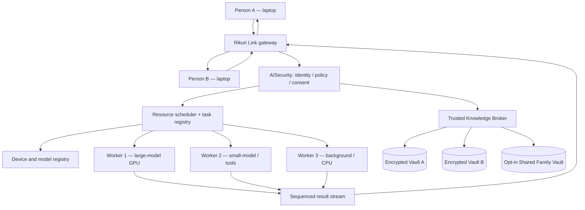

# Rikuri Pi — Rikuri Link & Home Intelligence Mesh
## Shared Compute Architecture, Multi-User Isolation & Phased Development Amendment

**Status:** Proposed specification for later-stage development, with Stage-1 interface requirements  
**Prepared:** 2026-10-30  
**Scope:** Secure access to user-owned compute across macOS/Linux/Windows, including simultaneous family users, model placement, task scheduling, ephemeral execution and remote clients  
**Prerequisite:** `Rikuri_Pi_Personal_Intelligence_Vault_Foundation.md`  
**Version note:** This is an independent proposal, **not** a claim that existing Rikuri PRD, architecture or development-plan versions have been replaced.

---

## 1. Executive decision

**Build a mesh-ready interface in Stage 1; implement the actual Home Intelligence Mesh progressively after vault security and durable state are proven.**

The home may own one powerful AI workstation, one or two modest computers, and laptops/phones for everyday interaction. A request can originate from any authorized device. Rikuri routes authorized work to an appropriate available worker, using its local models, CPU/GPU, SSD cache and tools; streamed results return to the requesting workspace. Family members share **compute capacity**, not private prompts, memories, files or inference-session state by default.

**Foundational invariants:**

1. **One user intent, one coherent project, multiple replaceable execution resources.**
2. **Identity/knowledge authority never comes from physical ownership of a GPU.**
3. **Rikuri Link transports authorized work; it is not the knowledge vault or the authorization authority.**
4. **Share jobs before splitting one model across machines.** Cross-node model sharding is an optional, benchmark-gated research track.
5. **No silent privacy downgrade, silent failure, false-success status or lost committed work.**

**Important limitation:** Three computers do not automatically expose one combined RAM/VRAM pool. In the initial system, each model executes on a node capable of running it. SSD-backed models and distributed model partitioning are separate optional mechanisms with throughput/latency costs.

## 2. Product experience and users

### Desired novice experience

- Install Rikuri on each supported machine; choose **Use this computer** or **Offer spare compute**.
- A guided pairing flow identifies authorized devices, detects capacity and confirms each device's trust and privacy scope. No demand for users to learn SSH, ports, Docker or CUDA.
- The interface reports available workers and whether they can run chat, coding, audio, vision, image or video tasks.
- A person may work on a laptop at home or remotely over an approved private network. Home workers must be powered on, reachable and authorized; clear offline/fallback states.
- Two family members using different laptops get independent accounts, conversations, projects, vaults, jobs and output streams, with transparent shared GPU scheduling.
- Users can override routing and request **This device only**, **Trusted private machines**, or an explicitly permitted external execution policy.

### Example workload

- **Computer A (AI workstation):** 70B-class local LLM or image-generation model, heavy inference.
- **Computer B (modest CPU/GPU):** transcription, embeddings, document preprocessing and lower-demand agents.
- **Computer C (small always-on host, optional):** device discovery, coordination, monitoring and light background tasks. It is not automatically the trusted vault host.
- **Laptop / phone:** interaction, smaller local fallback models, display and encrypted Rikuri Link access from anywhere with suitable connectivity.

For a private Bitcoin or financial node, **do not enroll its wallet/channel/security domain as a general-purpose agent compute worker by default**. Use separate hosts/partitions and narrowly brokered capabilities where there is a justified reason.

## 3. Architecture: two planes, five services



**Control plane:** identities, device enrollment, runtime capability/model registry, policy checks, durable task state, reservations, scheduling, audit, health and recovery. A coordinator may run on the powerful workstation or a small always-on device; authoritative state must have a documented recovery strategy if that host fails.

**Data plane:** authenticated job inputs, model inference, sandbox tools, encrypted asset transfers and sequenced result streaming. GPU workers must not receive the general-purpose keys or filesystem access of the knowledge system.

### Five logically separate services

| Service | Main responsibility | Stage-1 minimum |
|---|---|---|
| Rikuri Link | Secure transport, peer/device identity, liveness, reconnection, streaming | Specify authenticated request/response contract and trust modes; local loopback transport |
| Device / Model Registry | Hardware/runtimes/model capabilities, capacity, cached/resident state | Local capabilities + model discovery; stable descriptors |
| Resource Scheduler | Job-to-node placement, priority, memory reservation, admission, budgets | Single-node scheduler with typed job state |
| Worker Runtime + Residency Manager | Start jobs, load/unload models, manage RAM/VRAM/SSD and tools | One backend adapter + model readiness and health |
| Knowledge Broker + AISecurity | Identity, scoping, keys, retrieval/write permissions, policy | **Must exist and pass Vault Stage-1 gates** |

**Modularity:** Tools and inference runners are replaceable. Design runtime adapter profiles for llama.cpp, LM Studio, Ollama, vLLM, vision/audio/image tools and future SSD-backed MoE engines. Do not tie the user workspace or vault to one service API.

## 4. Separation of compute, execution and knowledge

### 4.1 What can be shared vs must be separated

| Resource | Shareable? | Rule |
|---|---|---|
| CPU cycles, physical GPU capacity, network and idle SSD | Yes | Quotas, admission control, priority and resource monitoring |
| Public base model weights and tokenizer | Yes, when license allows | Read-only, verified hashes and model provenance |
| Personal conversations, project state and source documents | No by default | Owner-scoped Knowledge Broker authorization |
| Embeddings, chunks, summaries, memory, prompt construction | No by default | Per-object/chunk permissions and derivative lineage |
| GPU KV/prefix cache, media cache, adapters | Only under verified policy | Tenant-bound isolation, cache IDs, retention control and backend limitations |
| Sandbox files/processes and credentials | No | Per-job or per-trust-domain isolation and teardown |
| Family knowledge | By opt-in | Separate shared space with explicit membership/grants |

### 4.2 Two simultaneous family members

Example: Person A writes a book; Person B runs Python research. Their separate laptops can submit at the same time. AISecurity binds each request to a person/project/thread. The Knowledge Broker supplies only authorized inputs; execution environments, job events, tool state and persistent outputs remain isolated. The Resource Scheduler runs concurrently if capacity permits, otherwise queues or selects suitable alternative nodes fairly.

**Do not equate Docker separation with inference-server tenant isolation.** vLLM explicitly warns that sharing its server process shares caches and is not a tenant security boundary. Tenant-specific cache salting and independent media identifiers mitigate selected risks but do not create full isolation. Where strict isolation is required, dedicate inference processes and/or compatible hardware-backed partitions, or run workloads on separate trusted devices. A sandbox cannot hide plaintext from the host administrator when the host itself processes it.

### 4.3 Sandbox choice by threat and hardware

| Workload | Initial recommendation | Caution |
|---|---|---|
| Ordinary trusted text chat | Authorized inference session, no VM per token | Needs thread/context separation, cache policy and guarded retrieval |
| Trusted automated code/tool task | Hardened rootless Docker/Podman container | Shared host kernel; deny privileged mode and arbitrary host mounts |
| Untrusted code, web-derived tools, high-risk work | Firecracker microVM or VM-backed sandbox (where supported) | Higher overhead; Firecracker uses Linux KVM and is not a universal GPU-sharing method |
| GPU-heavy sandboxed workload | Driver-supported container isolation; evaluate gVisor or Kata as applicable | gVisor nvproxy does not create hardware GPU isolation; Kata passthrough may consume an entire GPU without vGPU support |
| Confidential job not permitted on remote host | Execute on user's trusted device or fail closed | A general household GPU server may not satisfy administrator-private Vault requirements |

**Ephemeral lifecycle:** authenticate → authorize → reserve → create sandbox → inject narrowly scoped input and short-lived credentials → execute/stream → validate → commit to durable vault → read-back verify → revoke tokens → destroy sandbox and clear recoverable caches. Inference weights can remain loaded when permitted; private per-job context cannot silently survive the authorized lifecycle.

## 5. Secure Rikuri Link networking

### Networking implementation path

- **Stage-1 transport abstraction:** local process transport using the exact future job/event contract. Do not prematurely hard-code localhost or IP assumptions into authorization.
- **Initial remote transport:** existing Tailscale/WireGuard capabilities with restrictive policy and authenticated Rikuri gateway; avoid public exposure of Ollama/llama.cpp/vLLM raw backend ports.
- **Rikuri identity layer:** sign/enroll device identities, bind them to a user and trust level, support revocation. Network possession/membership is **not** permission to decrypt vault data or execute arbitrary tools.
- **Home/coffee-shop behavior:** prefer reachable direct encrypted connection; handle relays, changing networks, NAT, offline nodes and latency variation gracefully.
- **Rikuri Link independent of one vendor:** LM Link is an instructive precedent for remote-model access, but Rikuri's transport and authorization must be able to operate with different backends and mesh policies.

**Threat model:** compromised/borrowed laptop; rogue enrolled device; household network snooping; worker compromise; replayed requests; stale/revoked credentials; unauthorized raw backend access; lateral movement into private services.

### Pairing requirements

1. A device is enrolled by an already authorized user using a short-lived, authenticated approval flow; bind the approval to the actual device identity.
2. Publish capabilities only after the gateway validates device identity, trust policy, software compatibility and health.
3. Owners can view devices, revoke them and remove their ability to accept/submit work. Revocation takes effect on new requests and invalidates active credentials where possible.
4. Distinguish **client**, **compute worker**, **vault keeper** and **coordinator** roles. A device may hold more than one role only after separate authorization.
5. UI should not say “secure” merely because a tunnel exists. Display practical boundaries: *trusted device may process plaintext* vs *Vault-local only*.

## 6. Device discovery, runtime selection and scheduling

### 6.1 Worker advertisement (illustrative contract)

```json
{
  "device_id": "worker-uuid",
  "roles": ["compute"],
  "os_family": "linux",
  "compute_backends": ["cpu", "cuda"],
  "system_ram_available_bytes": 24000000000,
  "gpu_memory_available_bytes": 16000000000,
  "supported_modalities": ["text", "speech", "embeddings"],
  "runtimes": [{"name": "llama.cpp", "adapter_version": "1"}],
  "models": [{"model_id": "model-hash-or-stable-id", "state": "resident"}],
  "health": "ready",
  "observed_at": "2026-10-30T00:00:00Z"
}
```

The advertisement is **observed and signed/authenticated system information**, not a claim of reserved resources. RAM/VRAM estimates are stale as soon as other jobs arrive; re-check and reserve before dispatch.

### 6.2 Job contract (illustrative)

```json
{
  "job_id": "job-uuid",
  "actor_session": "verified-by-gateway",
  "project_id": "project-uuid",
  "thread_id": "thread-uuid",
  "privacy_mode": "private-trusted-devices",
  "required_capability": "text.generate",
  "model_policy": {"quality_floor": "task-specific", "allowed_models": []},
  "input_refs": ["approved-content-ref"],
  "priority": "interactive",
  "idempotency_key": "request-uuid",
  "deadline_ms": 120000,
  "max_output_tokens": 2048
}
```

`input_refs` are protected broker references, **not** unguarded filesystem paths or a gateway for vault-wide retrieval. Model and node selection occurs *after* authorization and policy-bound trust checks.

### 6.3 Placement algorithm (first useful version)

For each permitted worker/model combination, estimate:

`predicted_completion = queue_wait + model_start_or_load + input_transfer + inference + output_delivery`.

Also score task adequacy, power/thermal state, compute cost, privacy constraints, disk/cache availability, reliability and fairness. Reject options that violate required authorization, memory reservation or model-quality floor. Do **not** choose a large model just because it is available.

- Reserve a small interactive capacity floor so heavy image/video jobs do not starve chat and speech.
- Use bounded concurrent jobs, fair queuing per person and configurable household quotas.
- Try resident models before cold-loading equivalents when performance/quality meets user intent.
- Keep the model-local residency manager responsible for `mmap`, CPU/GPU offload, TTL/eviction and, in experimental backends, SSD expert caching.
- Prevent eviction thrash and OOM: reserve memory (including KV cache and runtime buffers) and fail admission visibly rather than oversubscribe optimistically.
- Never route to unapproved cloud compute if the home worker is busy/offline.

## 7. Reliable streaming and durable tasks

**Canonical task states:** `CREATED → AUTHORIZED → RESERVED → RUNNING → STREAMING → COMMITTING → COMPLETED`; explicit terminal `FAILED`, `CANCELLED` and `DENIED`, plus resumable `INTERRUPTED`/`WAITING_FOR_WORKER` where safe. State transitions are monotonic, versioned and auditable. Dispatches are acknowledged by worker and coordinator; timeouts are not a silent success.

- Every output chunk has `job_id`, `stream_id`, monotonic `sequence`, timestamp and content type; clients can resume from a known sequence after a network interruption.
- Avoid claiming exactly-once physical execution. Use **at-least-once delivery with idempotency/deduplication** where appropriate and **exactly-once authoritative effect** only when enforced by transactional commit, idempotency and operation semantics.
- A remote user can reconnect from a coffee shop without seeing another user's task. Do not automatically abort long jobs on transient client disconnection; apply user-defined policy and deadlines.
- Exports/artifacts are committed via the Knowledge Broker and verified before a job reports completion. Distinguish stream completion from durable artifact completion.
- For actions with external side effects (payment, deletion, posting, sending), prohibit blind replay and require separate approval/commit semantics.
- File/video transfers should be chunked, integrity-verified and resumable with encrypted transport and bounded retention; prefer compute near large input files.

**No-silent-failure requirement:** If the desktop sleeps, connection fails, model crashes, SSD fills or authorization changes, Rikuri returns a clear typed result and preserves verified state.

## 8. Shared GPU, inference-session isolation and SSD-backed models

### 8.1 Isolation is a layered claim

1. **Knowledge:** per-user/project authorization before prompt assembly.
2. **Execution:** sandboxed tools and restricted host access.
3. **Serving process:** dedicated inference instance where necessary; shared process only for a deliberately accepted lower-assurance trust group with mitigations.
4. **Device/GPU:** resource and error-domain separation only to the extent supported by the driver/hardware.
5. **Administrator trust:** shared host control may expose plaintext; Vault-local excludes that host.

A shared public base model may stay resident; independent private KV/prefix/media cache, LoRA and user inputs must be handled according to the selected assurance level. On consumer GPUs, strict concurrent process isolation may duplicate weights and become impractical; queueing or worker separation is a valid outcome rather than weakening the policy.

### 8.2 Three different meanings of "sharing memory"

- **Shared compute job routing (initial):** each model on a capable worker; low network overhead; primary recommendation.
- **Local SSD-backed large-model inference (optional):** an appropriate engine pages/streams MoE expert weights from local SSD as its active working set permits. SSD is not RAM; measure decode speed and wear-related write paths.
- **Cross-node model splitting (experimental):** partition layers/tensors/experts across workers. Network latency/bandwidth and compatibility can overwhelm benefits; only deploy after controlled benchmarks and security tests.

**Suggested experiment references:** LM Studio JIT/TTL, Ollama residency and concurrency, llama.cpp and its RPC backend (careful: not a production-safe trust boundary without hardening), Ray Serve model composition/routing, WiCi InferSSD for supported MoE experiments. Reuse mechanisms; do not invent new GPU virtualization or kernel drivers for Rikuri's first release.

## 9. Development order: what belongs in Stage 1 vs later

### Stage 1 — Mesh-ready foundations only (mandatory now)

- [ ] Ship the Personal Intelligence Vault's identity, scope, keys, encrypted storage and transactional state requirements (companion spec).
- [ ] Define versioned `DeviceDescriptor`, `ModelCapability`, `JobSpec`, `JobState`, `StreamEvent`, `AuthorizationDecision`, `WorkerLease` and `ArtifactCommit` interfaces.
- [ ] Route a single-device task through the same gateway/adapter and authorization checks that future remote tasks will use.
- [ ] Implement a local runtime adapter (one LLM backend initially), deterministic stream ordering, typed failures, cancellation and verified task persistence.
- [ ] Provide a sandbox abstraction with policy-selected `none/trusted-container/strong-isolation` capability descriptors, even if only trusted local execution is initially enabled.
- [ ] Test two simulated people with two private projects and an intentionally hostile cross-user/cross-thread request on one machine.
- [ ] Enforce privacy modes and block unapproved remote/cloud fallback before remote workers exist.
- [ ] Document OS/hardware constraints and feature flags without asserting unsupported GPU/microVM capabilities.

**Stage-1 integration gate:** A future remote worker can be added by implementing a new transport and worker adapter, **not** by changing ownership semantics, project IDs, or the authoritative vault database.

### Stage 2 — Secure laptop ↔ workstation (first real mesh milestone)

- [ ] Guided two-device installation, pairing, device registry, Tailscale transport and restrictive network policy.
- [ ] One remote model service behind an authenticated Rikuri gateway; no public raw inference ports.
- [ ] Remote text generation with streaming, cancellation, reconnect, device revocation, worker offline/failure handling and model readiness.
- [ ] No vault master keys or raw database mounted on worker. Explicit trust policy before sending private context.

**Gate 2:** Execute from laptop on workstation, stream verified results, revoke a worker and prove it cannot accept a new job, recover from temporary disconnection; no cross-device scope widening.

### Stage 3 — Two family users + multiple heterogeneous workers

- [ ] Two independently authenticated clients; separate encrypted vaults; shared worker queues and fair scheduling.
- [ ] Add smaller CPU model/audio/embedding worker; resource discovery, memory reservation, budgeting, scheduling and transparent placement.
- [ ] Multi-user shared-inference policy with tested cache behavior; stronger per-user instance isolation for private workloads when supported.
- [ ] Hardened tool sandboxes and stable project/artifact handoffs; optional shared family knowledge space with explicit grants.

**Gate 3:** Person A and B submit concurrent jobs from different laptops; no cross-user leak in source retrieval, logs, streams, caches or artifacts; one job may be cancelled/crash without corrupting the other; scheduler fairness recorded.

### Stage 4 — Adaptive multimodal mesh and advanced efficiency

- [ ] Audio/vision/image/video workflow placement and streaming; location-aware large-file handling.
- [ ] Evidence-based residency policies, SSD caching, prefetch and placement learning with observability and rollback.
- [ ] Optional advanced sandboxing (gVisor/Kata/Firecracker by platform and threat level); vendor GPU partitioning where actually supported.
- [ ] Optional model splitting/Ray/exo research, evaluated against ordinary whole-job routing for same model and workload.

**Gate 4:** Benchmark measured gains, privacy integrity, energy/cost and failure recovery before promoting experiments into default behavior.

## 10. Operational readiness, monitoring and novice UX

### Minimum operator signals

- Availability by device; active/resident models; queue by priority; RAM/VRAM reserved/free; load time; prefill and decode throughput; job completion and error rate; network/transfer time; per-user resource shares; backup/restore and state-integrity health.
- Prompts and private content are **not** default telemetry. Store only the minimum identifiers/metadata required for audit, with privacy-aware access and retention.
- Health means proven end-to-end execution, not merely a process heartbeat. Run periodic authenticated test jobs with nonprivate synthetic data.

### Setup UX requirements

- Show **one main action:** “Add a computer.” Rikuri discovers capabilities and gives simple, truthful instructions if an OS permission, driver or Tailscale authorization needs user action.
- Offer a diagnostic **connection test** that proves authenticated model invocation, output receipt, and permission scope rather than simply pinging a machine.
- Show “Running on [device] / Waiting / Offline / Local fallback blocked by privacy setting” in plain language; advanced logs optional.
- Provide per-user private/shared indicators and a preview of what material is about to leave the device.
- No hidden automatic wake-up, installation or command execution on another person's machine without device-owner authorization.

## 11. Adversarial, concurrency and recovery acceptance suite

1. **Identity spoofing:** Client B cannot submit a forged A request; unauthorized pairing denied.
2. **Vault isolation:** B cannot fetch A's project, source, chunks, embeddings, summaries, memories, adapters or search results.
3. **Thread isolation:** A's Project X cannot leak restricted Project Y thread context absent explicit grant.
4. **Inference state:** Verify prompt/KV/media cache scoping on each backend, or deploy separate instances; no false claim of tenant isolation.
5. **Sandbox boundary:** Restricted agent cannot mount host vaults, read other job files, access Bitcoin node services or obtain lasting keys.
6. **Transport:** Worker traffic encrypted; revoked/offline device cannot accept new jobs; raw model ports not externally reachable.
7. **Concurrent fairness:** A small chat job is not indefinitely starved by B's long batch job; memory/OOM failure is explicit.
8. **Network outage:** Client reconnect replays authorized sequenced output without mixing users or marking uncommitted results successful.
9. **Coordinator restart:** Durable jobs and artifact commits reconcile; no duplicate side-effect action.
10. **Worker crash or forced sandbox deletion:** Verified project state survives; uncommitted output is marked incomplete.
11. **Privacy downgrade:** Vault-only request cannot be routed to another host or external provider.
12. **Revocation/deletion:** Removed grants prevent future retrieval; derived indexes/caches are invalidated and stale results are not served.
13. **Device replacement:** User moves to new laptop; authenticated import/restore yields same project and thread state without needing original model or GPU.

**Release blocker:** Any observed cross-user unauthorized content exposure, unverified successful write, unannounced policy downgrade, or false-green status prevents progression.

## 12. Design tradeoffs and exclusions

| Temptation | Architectural response |
|---|---|
| Put all users in one inference process to save VRAM | Only for explicitly compatible trust/assurance requirements; never claim strict isolation |
| Spawn a microVM for every token or chat | Too much cost; isolate execution by threat, keep context logically scoped even without VM |
| Mount personal vault into the worker container | Reject; broker-only access with limited grants |
| Give every family member the home server admin credentials | Reject; compute access != administrator or knowledge rights |
| Share KV cache across family to improve speed | Default deny; investigate tenant-aware cache only with documented security properties |
| Move massive model weights over Wi-Fi per request | Reject; keep weights near workers and transfer prompts/results or deliberate model assets |
| Make the Bitcoin node a general-purpose AI host | Default reject; protect the financial/network trust domain |
| Assume WiCi InferSSD means instant 800B inference | Benchmark first; SSD I/O and decode throughput constrain responsiveness |
| Make Rikuri dependent on a Tailscale/LM Link-specific API | Use adapter interface; preserve portable access policy and capability contracts |

## 13. Proposed PRD / engineering-standard insertion

> **MESH-FND-001 — Secure distributed execution readiness.** Rikuri Pi shall expose stable, versioned device, model, job, policy, worker, stream and artifact contracts in Stage 1, with a single-node implementation first. Rikuri Link shall subsequently provide authenticated, encrypted connectivity to explicitly trusted private devices. The Resource Scheduler shall allocate work according to policy, modality, model suitability, resource availability, fairness and measured latency, while the per-node Model Residency Manager handles local model loading, eviction and caches. All users, projects, threads and tool sessions shall remain separately authorized; the Home Intelligence Mesh may share compute and immutable base weights but must not implicitly share knowledge or private inference state. Container and microVM isolation shall be risk-based, and unsupported strict GPU/host-administrator privacy guarantees shall never be claimed. Every job shall expose durable state, sequenced streaming, typed failures and verified artifact commits. Remote, family and cross-node capabilities shall be introduced only after corresponding isolation, recovery and adversarial acceptance gates pass.

## 14. Dependency crosswalk and owners

| Requirement | Primarily owned by | Integration point |
|---|---|---|
| Identity, vault keys, source ownership | Personal Intelligence Vault | Policy broker and scoped input references |
| Request grants, device trust, risk decisions | AISecurity | Mandatory pre-dispatch, pre-tool and pre-write checks |
| Project state, retries, verification | Project Lifecycle Kernel | Durable Project ID, expected revisions, verified deliverables |
| Runtime selection and prompting | Model-aware harness | Stable model-agnostic job intent |
| Work scheduling and resource budgets | Mesh Resource Scheduler | Worker leases, reservations, queue and placement metrics |
| Model cache lifecycle | Per-node Residency Manager | Runtime adapter, TTL, RAM/VRAM/SSD utilization |
| Network and client continuity | Rikuri Link | Authenticated streams and reconnect tokens |
| Tool isolation | Sandbox Manager / AISecurity | Controlled ephemeral code/browser/terminal environment |

## 15. Sources and implementation references (reviewed 2026-10-30)

**Transport and remote access**

1. Tailscale — Access control and grants: https://tailscale.com/docs/features/access-control/grants
2. Tailscale — Identity: https://tailscale.com/docs/concepts/tailscale-identity
3. LM Studio — LM Link: https://lmstudio.ai/docs/lmlink
4. LM Studio — Remote inference through LM Link API: https://lmstudio.ai/docs/developer/core/lmlink

**Inference scheduling and limitations**

5. LM Studio — TTL / Auto-Evict: https://lmstudio.ai/docs/developer/core/ttl-and-auto-evict
6. Ollama — FAQ, model residency and resource configuration: https://docs.ollama.com/faq
7. Ray Serve — Multi-node / multi-model serving: https://docs.ray.io/en/latest/serve/
8. Ray Serve — Cross-node parallelism: https://docs.ray.io/en/latest/serve/llm/user-guides/cross-node-parallelism.html
9. vLLM — Security and multi-tenant cache risks: https://docs.vllm.ai/en/latest/usage/security/
10. WiCi — InferSSD experimental large MoE SSD-backed inference: https://wici.ai/inferssd

**Sandbox and isolation**

11. Docker — Rootless mode: https://docs.docker.com/engine/security/rootless/
12. Firecracker — KVM requirements: https://github.com/firecracker-microvm/firecracker/blob/main/docs/getting-started.md
13. gVisor — GPU support and limitations: https://gvisor.dev/docs/user_guide/gpu/
14. Kata Containers — NVIDIA GPU passthrough and vGPU: https://kata-containers.github.io/kata-containers/use-cases/NVIDIA-GPU-passthrough-and-Kata/
15. OpenSandbox — Sandbox runtime reference: https://github.com/opensandbox-group/OpenSandbox
16. OWASP — RAG authorization, derived-data deletion and tenant isolation: https://cheatsheetseries.owasp.org/cheatsheets/RAG_Security_Cheat_Sheet.html

---

**Integration note:** Pair this document with the Vault Foundation amendment. Stage 1 should deliver only mesh-ready contracts and a securely functioning local executor; the actual networked mesh remains a separately gated expansion. This document does not assert modification of existing project files or repository.
